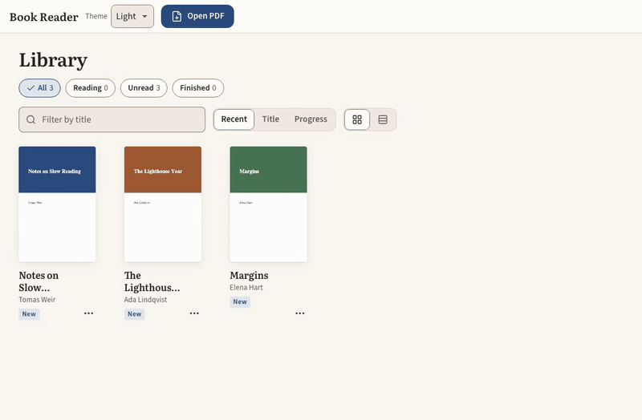

# Book Reader

A Kindle-like reader for PDF books, built as an installable web app (PWA) for Mac, iPad and
iPhone. Books open natively, with no conversion step, and reading stays fast even in long books.
Books and annotations live on the device first, and a private Cloudflare copy carries them
between devices.

<!-- Demo GIF goes here, for example:  -->

## Features

- **Reading:** continuous scroll, where only the pages near the view are drawn. Each book reopens
  where you left off.
- **Comfort:** light, sepia and dark themes; zoom levels from 25% to 400%, plus fit width and fit
  page; pinch to zoom on iPad.
- **Navigation:** the book's table of contents, and full-text search with every match listed and
  marked on the page.
- **Annotations:** bookmarks, highlights and notes. Highlights are stored in PDF coordinates, so
  they stay in place at any zoom.
- **Voice notes:** record a spoken note on a page or a highlight and play it back from the Notes
  panel. They stay on the device for now and are not synced.
- **Listen:** the book is read aloud from where you are, using the browser's built-in speech. The
  sentence being read is marked on the page, and you can pause, resume and change the speed.
- **Share and export:** share a highlighted passage, with the book title, to another app, or
  export a book's highlights and notes to a Markdown file.
- **Library:** a shelf with covers and reading progress, which you can sort and filter.
- **Sync:** books, bookmarks, highlights and notes reach your other devices. It works offline once
  installed.

## Tech stack

- TypeScript (strict), React and Vite. The page viewer is plain TypeScript; React renders only
  the surrounding chrome.
- [PDF.js](https://mozilla.github.io/pdf.js/) (`pdfjs-dist`), running in a Web Worker behind the
  engine interface in `src/engine`.
- IndexedDB for local-first storage.
- Cloudflare Pages, Pages Functions, D1 and R2 for hosting, sync and book files, behind
  Cloudflare Access.
- Vitest for unit tests, Playwright (Chromium and WebKit) for browser, sync and performance tests.

## Getting started

You need Node 24 (see `.nvmrc`).

```sh
npm ci
npx playwright install chromium webkit
npm run dev          # http://localhost:5173
```

The app runs entirely in the browser. Sync needs the Cloudflare setup below; without it, the app
is a reader that works on one device.

## Commands

| Command | What it does |
|---|---|
| `scripts/verify.sh` | Everything, in order: lint, format, types, unit, browser, sync, perf |
| `npm run test:unit` | Unit tests (Vitest, jsdom) |
| `npm run test:e2e` | Browser tests on the production build (Chromium and WebKit) |
| `npm run test:sync` | Two-device sync tests against local D1 and R2 (`wrangler pages dev`) |
| `npm run test:perf` | Speed and memory budgets (`e2e/perf/budgets.json`) |
| `npm run lint`, `npm run format:check`, `npm run typecheck` | Static checks |
| `npm run fixtures` | Regenerate the test PDFs in `tests/fixtures/` |

To measure one of your own books without adding it to the repo, run
`PERF_BOOK=/path/to/book.pdf npm run test:perf`. Tests never touch the network or the live
cloud.

## Performance

Speed is a feature, and budgets enforce it. A change that breaks one fails verify, even when
every other test passes. Measured on an Apple M2 (Chromium):

| Measure | Budget |
|---|---|
| First page drawn | 250 ms |
| Jump to a page | 100 ms |
| Scroll frame time (p95) | 25 ms |
| Blank frames while scrolling | 5% |
| Canvas memory | 96 MB |

## Project layout

```
src/core      DOM-free logic: annotations, library, reading position, search, sync rules
src/engine    PDF engine interface, PDF.js adapter and worker
src/viewer    Plain-TS viewer: virtualized pages, bitmap cache, text layers
src/storage   BookStore interface and the IndexedDB adapter
src/sync      Sync engine, file upload and download (the only network calls)
src/ui        React components
functions/    Cloudflare Pages Functions (sync and files APIs)
e2e/          Playwright tests and performance benchmarks
tests/        Test PDFs (generated) and config tests
docs/         Guides, such as deploy.md
harness/      Agent workflow: phase plans, contracts, reviews, build log, handoff
```

## Deploying

Cloudflare Pages builds from GitHub. There is no deploy command:

- Pushing `main` deploys production.
- Pushing any other branch creates a preview.

The one-time setup (Pages project, Access login, D1 and R2 for sync, installing on your devices)
is in [docs/deploy.md](docs/deploy.md). Everything runs on free tiers.

## How it is built

Claude Code and Codex build the project in turns, one phase at a time:

- `PLANS.md` is the roadmap and `GOALS.md` the scope.
- Each phase has a plan, a contract that defines "done", and a review by the agent that didn't
  write it.
- `harness/` holds the plans, contracts, reviews, build log and handoff, so either agent can pick
  up where the other stopped.
- `AGENTS.md` has the rules every agent follows.
